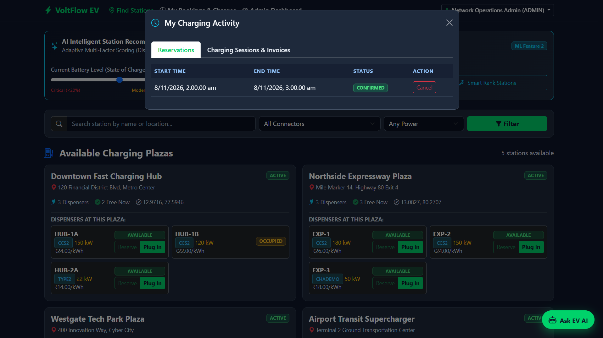
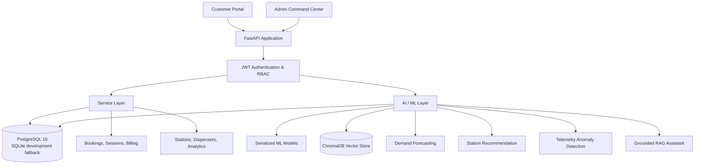

# VoltFlow --- AI-Powered EV Charging Station Management System

VoltFlow is a full-stack electric vehicle (EV) charging management
platform built with **FastAPI, PostgreSQL, and machine learning**. It
helps drivers discover charging stations, reserve charging slots,
monitor charging sessions, and receive intelligent station
recommendations. It also gives administrators tools to manage charging
plazas, monitor network operations, forecast demand, and inspect
charging-equipment telemetry.

The platform combines a REST API, a responsive web interface,
conventional machine learning models, and a retrieval-augmented
generation (RAG) assistant.

------------------------------------------------------------------------

## Table of Contents

-   [Key Features](#key-features)
-   [Screenshots](#screenshots)
-   [Technology Stack](#technology-stack)
-   [System Architecture](#system-architecture)
-   [How It Works](#how-it-works)
-   [Database Design](#database-design)
-   [API Overview](#api-overview)
-   [Project Structure](#project-structure)
-   [Getting Started](#getting-started)
-   [Demo Accounts](#demo-accounts)
-   [Running Tests](#running-tests)
-   [Machine Learning Evaluation](#machine-learning-evaluation)
-   [Security and Engineering](#security-and-engineering)
-   [Current Limitations](#current-limitations)
-   [Future Improvements](#future-improvements)

------------------------------------------------------------------------

## Key Features

### Driver / Customer Portal

-   Browse charging plazas and their charging points.
-   View connector types, charger power, availability, and tariffs.
-   Register and sign in using JWT-based authentication.
-   Reserve charging time slots.
-   Start and stop charging sessions.
-   View metered energy consumption and simulated billing receipts.
-   Get station recommendations based on distance, availability,
    charging speed, price, and battery State of Charge (SOC).
-   Ask the AI assistant questions about charging policies, technical
    guidance, and supported live account information.

### Administrator Command Center

-   View network KPIs, station counts, dispenser status, energy
    consumption, and revenue.
-   Register and manage charging station plazas and dispensers.
-   Select plaza coordinates using an interactive map or paste Google
    Maps coordinates/links.
-   View seven-day revenue and energy trends.
-   Generate 24-hour charging-demand forecasts.
-   Scan fleet telemetry for potential electrical anomalies.
-   Manage operational data through role-protected endpoints.

### AI and Machine Learning

-   **Demand forecasting:** Random Forest model predicts hourly
    charging-session volume and energy demand for the next 24 hours.
-   **Station recommendation:** Multi-factor scoring ranks stations
    using Haversine distance, bay availability, charging power, and
    tariff. Weights adapt when battery SOC falls below 20%.
-   **Anomaly detection:** Isolation Forest is combined with engineering
    checks to identify suspicious voltage, current, temperature, and
    meter readings.
-   **Grounded AI assistant:** ChromaDB retrieves relevant policy
    documents, while PostgreSQL supplies live station/session
    information when required. The assistant routes requests to policy
    retrieval, live database retrieval, or both.

### Reliability and Engineering

-   JWT authentication and role-based access control (CUSTOMER / ADMIN).
-   Booking-overlap validation to reject conflicting reservations.
-   Database row locking when a charging session starts.
-   SQLAlchemy ORM and Alembic database migrations.
-   PostgreSQL as the primary database, with an automatic SQLite
    development fallback.
-   Automated tests with Pytest and HTTPX.
-   Docker and Docker Compose support.
-   GitHub Actions CI workflow.

------------------------------------------------------------------------

## Screenshots

The screenshots below are stored in `docs/screenshots/`. The image links
are relative to the repository root, so they will render on GitHub when
the folder and filenames are committed with the README.

### Admin Dashboard

  ----------------------------------------------------------------------------------------------------
  Admin Dashboard --- Overview                      Admin Dashboard --- Analytics
  ------------------------------------------------- --------------------------------------------------
     analytics](docs/screenshots/admin_dasboard2.png)

  ----------------------------------------------------------------------------------------------------

### Customer Portal and Charging

  -----------------------------------------------------------------------------------------------------
  User Dashboard                                    Charging Sessions
  ------------------------------------------------- ---------------------------------------------------
     sessions](docs/screenshots/charging_sessions.png)

  -----------------------------------------------------------------------------------------------------

### Station Management and Reservations

  ----------------------------------------------------------------------------------------------------------
  Register Station Plaza                                Reservations
  ----------------------------------------------------- ----------------------------------------------------
  
  plaza](docs/screenshots/register_station_plaza.png)   

  ----------------------------------------------------------------------------------------------------------

### AI Features

  -----------------------------------------------------------------------------------------------------------
  AI Assistant                                    AI Station Recommender
  ----------------------------------------------- -----------------------------------------------------------
     recommender](docs/screenshots/ai_station_recommender.png)

  -----------------------------------------------------------------------------------------------------------

------------------------------------------------------------------------

## Technology Stack

  -----------------------------------------------------------------------
  Layer                   Technologies            Purpose
  ----------------------- ----------------------- -----------------------
  Language                Python 3.13             Backend, data
                                                  processing, and ML

  API                     FastAPI, Uvicorn,       REST endpoints,
                          Pydantic v2             validation, and API
                                                  documentation

  ORM / Migrations        SQLAlchemy 2.0, Alembic Database access and
                                                  schema versioning

  Primary database        PostgreSQL 16           Persistent relational
                                                  data

  Development / test      SQLite                  Local fallback and
  database                                        isolated test database

  Authentication          Bcrypt, Python-Jose,    Password hashing and
                          JWT                     token-based access

  Machine learning        Scikit-learn, Pandas,   Demand prediction and
                          NumPy, Joblib           anomaly detection

  RAG / Vector search     ChromaDB,               Policy-document
                          Sentence-Transformers   retrieval

  Frontend                HTML, CSS, JavaScript,  Customer and
                          Bootstrap 5.3           administrator
                                                  interfaces

  Charts and maps         Chart.js, Leaflet.js    Analytics
                                                  visualizations and
                                                  map-based plaza
                                                  selection

  Testing                 Pytest, HTTPX           Automated API and
                                                  feature tests

  Deployment / CI         Docker, Docker Compose, Containerization and
                          GitHub Actions          automated checks
  -----------------------------------------------------------------------

------------------------------------------------------------------------

## System Architecture

VoltFlow is organized into presentation, API, service, AI, and
persistence layers.



### Request flow example: starting a charging session

1.  The driver selects an available charging point in the customer
    portal.
2.  The frontend sends `POST /api/v1/sessions/start` with the
    charging-point ID and initial meter reading.
3.  FastAPI validates the JWT and loads the authenticated user.
4.  The session service locks the charging-point row using
    `SELECT ... FOR UPDATE`.
5.  If the point is available, its status is updated and a charging
    session is created in the same database transaction.
6.  The API returns the created session, and the frontend displays the
    charging-session interface.

------------------------------------------------------------------------

## How It Works

### 1. Authentication and access control

Users register and sign in through the authentication API. Passwords are
hashed with Bcrypt, and successful login returns a signed JWT. Protected
endpoints validate the token. Administrative operations require the
`ADMIN` role; normal driver operations use the `CUSTOMER` role.

### 2. Station and dispenser management

An administrator creates a charging plaza with its name, address, GPS
coordinates, and charging points. Each point records its connector type
(`CCS2`, `TYPE2`, or `CHADEMO`), power rating, status, and price per
kWh. The admin map picker supports selecting a location on a Leaflet map
or parsing coordinates from a Google Maps link.

### 3. Reservations and double-booking prevention

A reservation is associated with a specific charging point and time
interval. Before creating it, the service checks whether another
confirmed reservation overlaps the requested interval:

``` text
Existing start < Requested end
AND
Existing end > Requested start
```

If an overlap exists, the API rejects the reservation with **HTTP 409
Conflict**.

### 4. Charging sessions and billing

When a driver starts charging, the backend locks the selected
charging-point row to prevent two concurrent sessions from occupying the
same dispenser. Energy delivered is calculated from meter readings:

``` text
Delivered energy (kWh) = Final meter reading - Initial meter reading
Total cost (₹) = Delivered energy (kWh) × Tariff (₹/kWh)
```

When the session stops, the system records the final meter reading,
calculates the cost, and creates a simulated payment receipt.

### 5. AI demand forecasting

A Random Forest Regressor uses time-related and station-related features
to predict hourly session volume and energy demand for a 24-hour
horizon. Cyclical hour and day-of-week values are represented with sine
and cosine features so that adjacent times (for example, 23:00 and
00:00) are represented appropriately.

### 6. Intelligent station recommendations

The recommendation engine calculates geographic distance using the
Haversine formula and combines it with charger availability, power
output, and tariff. When battery SOC is below 20%, it increases the
importance of distance and availability and reduces the importance of
price.

### 7. Electrical telemetry anomaly detection

The anomaly detector combines an Isolation Forest model with
deterministic engineering checks. It screens readings for patterns such
as voltage sag, overcurrent, high temperature, meter stalls, and
battery-management-system charging-rate violations.

### 8. Grounded RAG assistant

The assistant uses an intent router to select one of three retrieval
paths: - `POLICY_RAG`: retrieve relevant operating-policy and
technical-guide content from ChromaDB. - `LIVE_DATABASE`: retrieve
applicable live station, booking, or session information from
PostgreSQL. - `HYBRID`: combine policy retrieval and live database
context.

The knowledge base contains Markdown documents covering station
operating policies, pricing and tariffs, connector guidance, and
troubleshooting/safety.

------------------------------------------------------------------------

## Database Design

The main relational entities are:

  -----------------------------------------------------------------------
  Table                               Purpose
  ----------------------------------- -----------------------------------
  `users`                             Customer and administrator accounts

  `charging_stations`                 Charging plaza details and location

  `charging_points`                   Individual dispensers, connector
                                      types, power, status, and tariff

  `bookings`                          Reserved charging-point time slots

  `charging_sessions`                 Meter readings, delivered energy,
                                      and session status

  `payments`                          Payment amount, status, and
                                      transaction reference
  -----------------------------------------------------------------------

UUID primary keys are used for records. Monetary and energy values use
decimal database types to avoid binary floating-point rounding issues. A
payment has a one-to-one relationship with its charging session.

------------------------------------------------------------------------

## API Overview

All application endpoints are mounted under `/api/v1`. The complete
interactive API reference is available at `/docs` when the application
is running.

  --------------------------------------------------------------------------------
  Area                    Example endpoints                Purpose
  ----------------------- -------------------------------- -----------------------
  Authentication          `POST /auth/register`,           Account creation,
                          `POST /auth/login`,              login, and current
                          `GET /auth/me`                   profile

  Stations                `GET /stations`,                 Discover and manage
                          `POST /stations`,                plazas
                          `PUT /stations/{id}`             

  Charging points         `GET /points/{id}`,              Read and update
                          `PUT /points/{id}`               dispenser details

  Bookings                `POST /bookings`,                Reserve and cancel
                          `GET /bookings/my`,              slots
                          `POST /bookings/{id}/cancel`     

  Sessions                `POST /sessions/start`,          Start, stop, and view
                          `POST /sessions/{id}/stop`,      charging sessions
                          `GET /sessions/my`               

  Analytics               `GET /analytics/dashboard`       Administrator network
                                                           metrics

  AI / ML                 `POST /ai/predict-demand`,       Prediction,
                          `POST /ai/recommend-stations`,   recommendations, and
                          `POST /ai/detect-anomalies`      anomaly checks

  Assistant               `POST /assistant/chat`           Grounded conversational
                                                           assistance

  Health                  `GET /health`                    Service health check
  --------------------------------------------------------------------------------

------------------------------------------------------------------------

## Project Structure

``` text
AI-Powered-EV-Charging-Station-Management-System/
├── .github/
│   └── workflows/
│       └── ci.yml
├── app/
│   ├── ai/
│   │   ├── anomaly_detection/
│   │   ├── assistant/
│   │   ├── demand_prediction/
│   │   └── recommendation/
│   ├── api/
│   │   ├── deps.py
│   │   └── v1/
│   │       └── endpoints/
│   ├── core/
│   ├── models/
│   ├── schemas/
│   ├── services/
│   └── main.py
├── docs/
│   ├── knowledge_base/
│   └── screenshots/
├── frontend/
│   ├── css/
│   ├── js/
│   ├── admin.html
│   └── index.html
├── migrations/
├── ml_data/
├── ml_models/
├── scripts/
├── tests/
├── Dockerfile
├── docker-compose.yml
├── requirements.txt
└── README.md
```

------------------------------------------------------------------------

## Getting Started

### Prerequisites

-   Windows 10/11
-   Python 3.13.x
-   Git for Windows
-   PostgreSQL 16 (optional for local development because the
    application has a SQLite development fallback)

### 1. Clone the repository

Replace `<your-username>` with your GitHub username:

``` powershell
git clone https://github.com/<your-username>/AI-Powered-EV-Charging-Station-Management-System.git
cd AI-Powered-EV-Charging-Station-Management-System
```

### 2. Create and activate a virtual environment

``` powershell
python -m venv .venv
.\.venv\Scripts\Activate.ps1
```

If PowerShell blocks activation because of the execution policy, you can
activate the environment from Command Prompt instead:

``` bat
.venv\Scripts\activate.bat
```

### 3. Install dependencies

``` powershell
python -m pip install --upgrade pip
pip install -r requirements.txt
```

### 4. Configure environment variables

``` powershell
Copy-Item .env.example .env
```

Review `.env` and set appropriate values for your environment. In
particular, configure a strong `SECRET_KEY`, database settings, CORS
origins, and `GEMINI_API_KEY` if you intend to use the optional Gemini
integration. Do not commit `.env` or real credentials to GitHub.

If PostgreSQL is unavailable while development mode is enabled, VoltFlow
is documented to fall back to the local SQLite database
`ev_charging_dev.db` and seed demonstration data automatically.

### 5. Run the application

``` powershell
uvicorn app.main:app --host 127.0.0.1 --port 8000 --reload
```

Open these URLs:

-   Customer Portal: http://localhost:8000/
-   Admin Command Center: http://localhost:8000/admin.html
-   Swagger API documentation: http://localhost:8000/docs
-   Health check: http://localhost:8000/api/v1/health

------------------------------------------------------------------------

## Demo Accounts

The development seed data documented for this project includes:

  Role       Email                  Password
  ---------- ---------------------- ----------------------
  Customer   `driver@voltflow.io`   `DriverPassword123!`
  Admin      `admin@voltflow.io`    `AdminPassword123!`

These are development/demo credentials only. Change or disable them
before deploying the application anywhere accessible to other users. Do
not use these credentials in a production environment.

------------------------------------------------------------------------

## Running Tests

The automated test suite uses Pytest and HTTPX. It is configured to use
an isolated in-memory SQLite database, so the tests do not require a
running PostgreSQL server.

``` powershell
pytest -v
```

The project documentation records **17 passing tests** covering
authentication, role checks, database operations, station and dispenser
lifecycle, booking/session/billing flows, AI features, RAG retrieval,
and health/analytics endpoints.

------------------------------------------------------------------------

## Machine Learning Evaluation

The following metrics are reported in the project development
documentation. The datasets used for model development are synthetic,
not live utility or charging-network telemetry.

  -----------------------------------------------------------------------
  Component               Model / Method          Reported evaluation
  ----------------------- ----------------------- -----------------------
  Demand prediction       Random Forest Regressor Session forecast MAE:
                                                  1.451 sessions; R²:
                                                  0.708. Energy-demand
                                                  MAE: 51.03 kWh; R²:
                                                  0.671

  Telemetry anomaly       Isolation Forest +      Precision: 0.897;
  detection               engineering rules       Recall: 0.897;
                                                  F1-score: 0.897

  Station recommendation  Haversine distance +    Score combines
                          weighted multi-factor   distance, availability,
                          scoring                 charging power, and
                                                  tariff; weights adapt
                                                  to battery SOC
  -----------------------------------------------------------------------

These results describe evaluation on the project's generated datasets
and should not be interpreted as guarantees of performance on live
production data.

------------------------------------------------------------------------

## Security and Engineering

-   Passwords are hashed using Bcrypt; raw passwords are not stored.
-   JWT tokens are used for authenticated API requests.
-   Role-based dependencies restrict administrator-only operations.
-   Production configuration rejects the default placeholder secret key
    when `DEBUG=False`.
-   Booking overlap checks prevent conflicting reservations for the same
    charging point.
-   Row-level database locking protects charging-session initiation from
    concurrent requests.
-   SQL aggregation is used for dashboard metrics to reduce N+1 query
    patterns.
-   `.env` should contain local secrets and must not be committed.

------------------------------------------------------------------------

## Current Limitations

-   **Charging hardware:** Charging energy delivery is simulated in the
    frontend; the project does not currently communicate with physical
    OCPP charge-point hardware.
-   **Payments:** Payment receipts use simulated transaction references.
    A live card/payment gateway is not integrated.
-   **Machine-learning data:** Models are trained and evaluated on
    synthetic datasets rather than real-world utility telemetry.
-   **AI assistant:** Gemini integration is optional and depends on
    configuring an API key; the project also includes deterministic and
    retrieval-based components.

## Future Improvements

-   Integrate an OCPP 2.0.1 gateway for communication with physical
    charging stations.
-   Add a production payment provider and webhook-based payment/refund
    handling.
-   Use live grid and wholesale electricity pricing for dynamic tariffs.
-   Retrain and validate ML models using representative real-world
    charging and telemetry data.

------------------------------------------------------------------------

